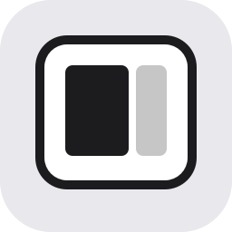

# MoveB

A tiny keyboard-only window manager for macOS, in the spirit of various other apps keyboard modes.
Press ⌘M to enter window mode, then one key to place the focused window.

## Outline

- `Sources/MoveB/main.swift` — app entry point, menu bar icon, Accessibility prompt, ⌘M registration.
- `Sources/MoveB/HotKey.swift` — key codes and the global ⌘M hotkey (Carbon `RegisterEventHotKey`).
- `Sources/MoveB/WindowMode.swift` — the modal state: dims the screen and shows the app icon in an overlay that takes keyboard focus, maps keys to placements, then hands focus back.
- `Sources/MoveB/WindowMover.swift` — screen math and moving windows through the Accessibility API.
- `scripts/bundle.sh` — builds a release binary and wraps it into a signed `build/MoveB.app`.

## Features

Press **⌘M**, then:

| Key | Action |
|---|---|
| ← | Left half |
| → | Right half |
| 1 | Left two-thirds |
| Space | Fill the screen |
| C | Center, at 78% of the screen's width and full height |
| Esc / any other key | Cancel |

⌘ is optional after ⌘M: ⌘← works the same as ←. The one exception is ⌘Space, which Spotlight takes first.

- One action per ⌘M; the mode then closes and focus returns to your app.
- The mode cancels itself after 3 seconds, or on ⌘M again.
- While the overlay is up it swallows every key, so nothing leaks to the app underneath.
- Works on whichever screen the window is mostly on, and respects the menu bar and Dock.
- Runs from the menu bar (no Dock icon); the menu has Quit.

## Getting started

Requirements:

- macOS 13 or later
- Xcode, selected as the active developer directory:

  ```sh
  sudo xcode-select -s /Applications/Xcode.app/Contents/Developer
  sudo xcodebuild -license accept
  ```

MoveB needs **Accessibility** permission (System Settings → Privacy & Security → Accessibility) to move other apps' windows. That is the only permission it uses.

## Running locally

```sh
./scripts/bundle.sh
open build/MoveB.app
```

On first launch, grant Accessibility access when prompted, then restart the app so the permission takes effect:

```sh
pkill MoveB; open build/MoveB.app
```

To install it, copy it to `/Applications` and add it under System Settings → General → Login Items to start at login.

**After every rebuild** the ad-hoc signature changes and macOS treats it as a new app: remove MoveB from the Accessibility list (the minus button, not just the toggle), relaunch and grant again. If ⌘M only beeps, this is almost always why. The reason is logged:

```sh
log show --last 5m --predicate 'process == "MoveB"'
```

## Next steps

- **Stable code signing.** Add an Apple ID in Xcode → Settings → Accounts and sign `bundle.sh` with the resulting Apple Development certificate, so Accessibility permission survives rebuilds.
- **More placements:** right two-thirds, thirds, top/bottom halves, move to next screen.
- **Undo:** restore the window's previous frame.
- **Launch at login** from the menu (`SMAppService`) instead of setting it in System Settings.
- **Configurable keys** instead of hard-coded key codes.
